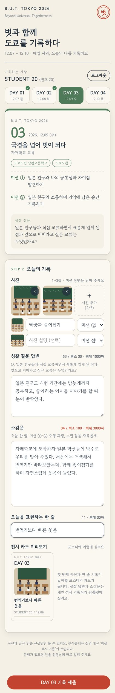
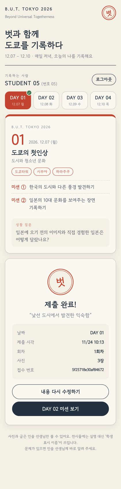
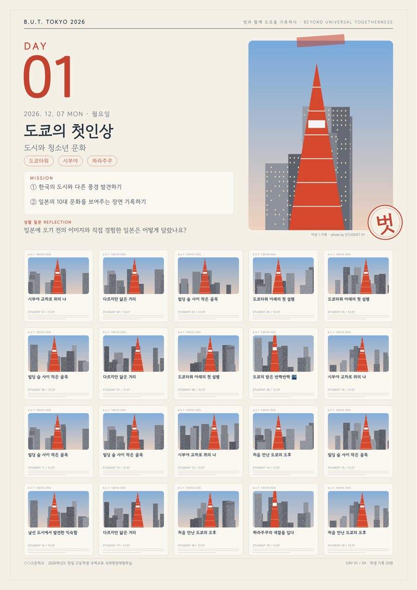
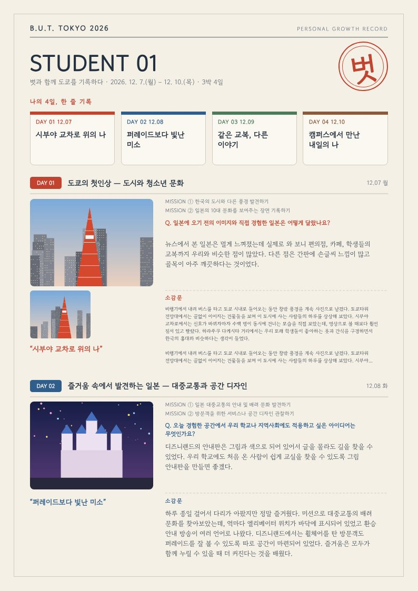
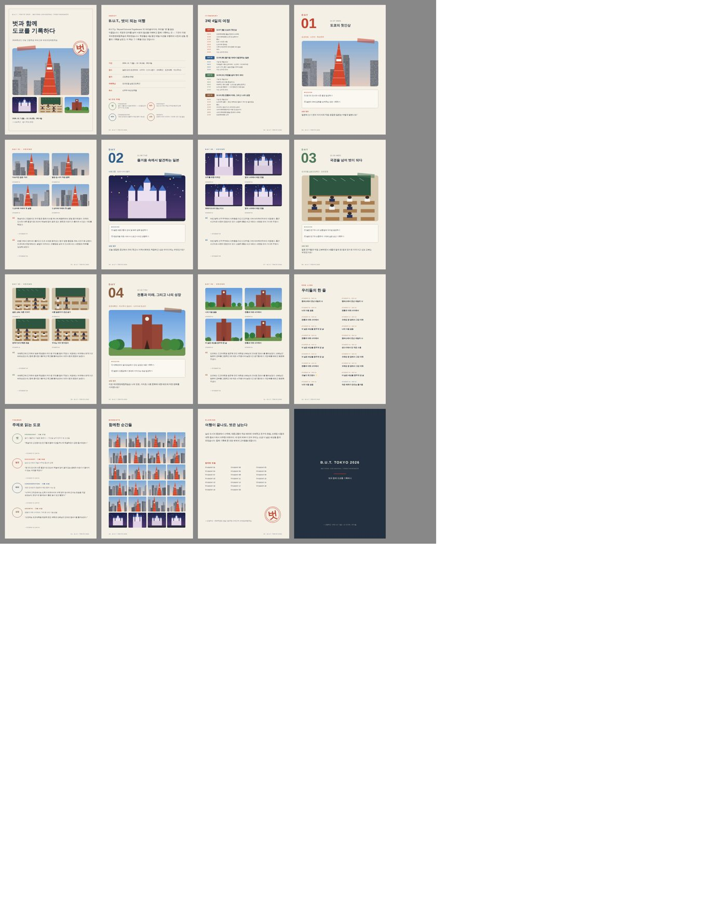
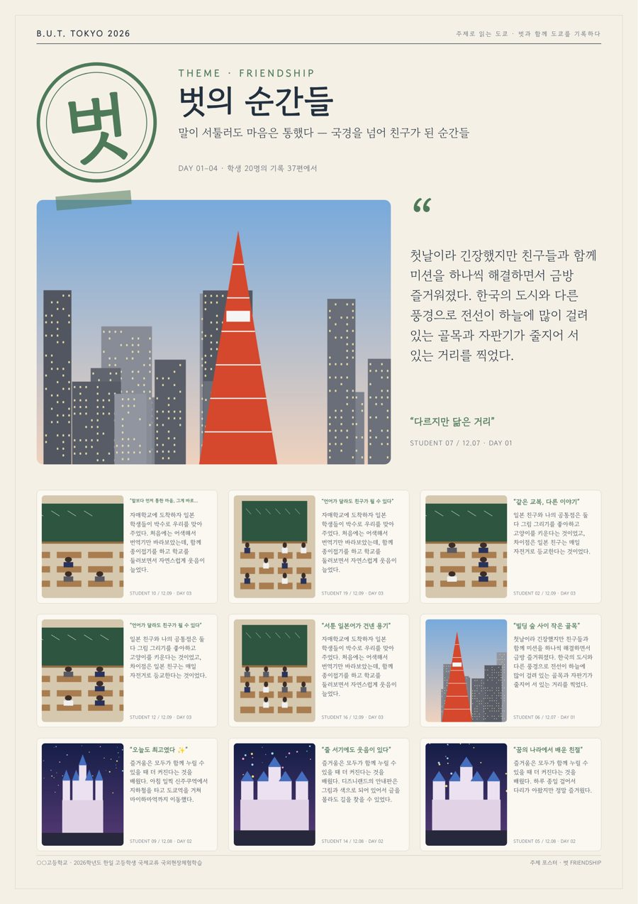
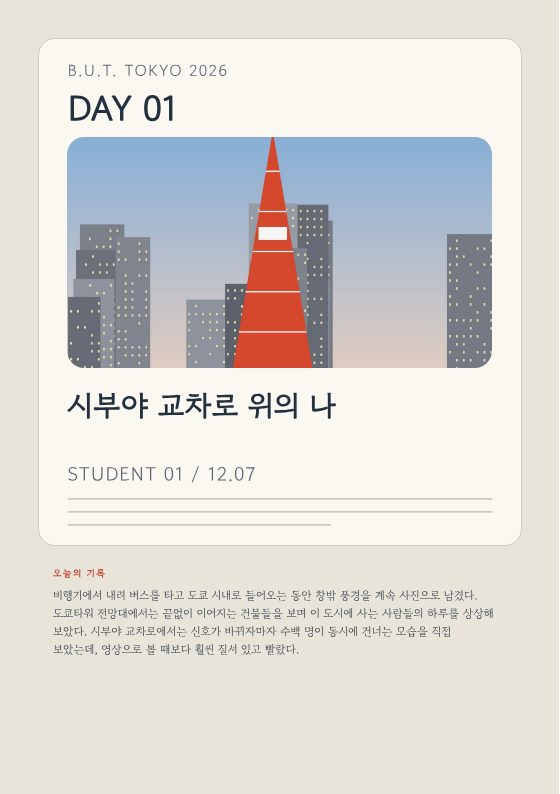

# B.U.T. TOKYO 2026 — 벗과 함께 도쿄를 기록하다

2026학년도 한일 고등학생 국제교류 국외현장체험학습(2026. 12. 7.–10., 3박 4일, 학생 20명)의
**디지털 활동 기록 웹앱**과 **결과물 자동 제작 시스템**입니다.

- 학생은 **주소 하나(QR)** 로 접속해 날짜별 미션을 확인하고, 사진 1~3장 · 성찰 답변 · 소감문 · 한 줄 기록을 제출합니다.
- 데이터는 학교 계정의 **Google Sheets(비공개)** 에, 사진 원본은 **Google Drive(비공개 폴더)** 에 저장됩니다.
- 교사는 **관리자 페이지**에서 제출 현황 확인 → 검토·수정 → 전시 사진 선택 → **A1 포스터 · A4 성장 기록지 · A5/A4 팜플렛**을 자동 생성하고 **PDF(출력용)** 와 **PPTX/HTML(편집용 원본)** 으로 내려받습니다.
- 별도 서버·유료 서비스가 필요 없습니다 (Google Apps Script 무료).

| 학생 화면 (스마트폰) | 제출 완료 | DAY 01 A1 포스터 | 개인 성장 기록지 A4 |
|---|---|---|---|
|  |  |  |  |

> 위 이미지는 모두 **가상 학생 20명 데이터**(합성 사진)로 자동 생성한 실제 결과물입니다.

---

## 1. 무엇이 들어 있나요

| 요청 사항 | 구현 |
|---|---|
| 하나의 URL·QR 접속 | Apps Script 웹앱 주소 1개. 관리자 페이지 [결과물 → 접속 안내(QR)+PIN 배부 카드]로 인쇄 |
| DAY 1~4 미션 안내 | 일정표·미션·성찰 질문을 `src/shared/program.js`에 정리, 날짜 탭으로 표시 (도쿄 날짜 기준 자동 선택) |
| 학생 식별 번호 | 학생 번호 + PIN(4자리). 5회 틀리면 60분 잠금 |
| 사진 1~3장 | 원본은 그대로 Drive 저장 + 휴대폰에서 출력용 사본(긴 변 2000px) 생성 |
| 성찰 질문·소감문·한 줄 기록 | 글자 수 실시간 표시, 최소/최대 검증, 기기에 자동 임시저장 |
| 제출 확인·중복 관리 | 영수증(시각·회차·접수번호), 버튼 연타/재전송은 1건만 저장, 재제출 시 확인 후 회차 증가(이전 회차 보관) |
| 자동 분류 | 학생별·날짜별 시트 행 + Drive `photos/original/DAY1…4` 폴더, 주제(벗·발견·배려·성장) 자동 분류 |
| 개인정보·접근 권한 | 시트·폴더는 교사 계정만 접근, 학생은 자기 기록만 조회, 결과물은 실명 대신 표시 이름 사용, 전시 비동의 학생 사진 자동 제외 |
| 교사용 관리자 페이지 | 제출 현황표, 검토·수정(원문 보존), 승인/보류, 카드 사진·대표 사진·전시 후보 선택, 학생/PIN 관리, 마감 설정 |
| 결과물 | 날짜별 A1 포스터 4종, 주제별 A1 포스터 4종, 학생별 A4 성장 기록지(2쪽), A5·A4 팜플렛(16쪽), A5 기록 카드, QR 안내문 |
| 원본·PDF | 브라우저 인쇄 → PDF, PPTX(PowerPoint·Keynote·Google Slides·Canva에서 편집), HTML, Canva 대량 제작용 CSV, 고해상도 PDF 일괄 생성 스크립트 |

## 2. 빠른 시작

### 2-1. 내 PC에서 가상 데이터로 체험 (5분)

```bash
npm install
npm run photos          # 가상 사진 44장 생성 (Python3 + Pillow 필요)
npm start               # http://localhost:8080 (학생), http://localhost:8080/admin (관리자, 비밀번호 test-admin-2026)
npm run seed            # (다른 터미널) 가상 학생 20명 × 4일 = 77건 제출
npm run outputs         # output/ 에 결과물 13종 PDF·PPTX·HTML·PNG 생성 (Playwright 필요)
npm test                # 자동 테스트 21개
```

### 2-2. 실제 운영 (Google Apps Script)

자세한 순서는 **[docs/01-구축-배포.md](docs/01-구축-배포.md)** 를 따르세요. 요약:

1. `npm run build` → `dist/gas/` 에 파일 4개 생성 (`Code.js`, `Student.html`, `Admin.html`, `appsscript.json`)
2. 학교 Google 계정으로 Apps Script 프로젝트를 만들고 파일 4개를 붙여 넣기 (또는 `clasp push`)
3. 편집기에서 `setup()` 실행 → 실행 로그에 **관리자 비밀번호** 표시, 비공개 시트·폴더 자동 생성, 학생 01~20 + PIN 생성
4. **배포 → 새 배포 → 웹 앱** (실행: 나, 액세스: 모든 사용자) → 주소 확인
5. 가상 데이터로 리허설 → 관리자 [설정 → 가상 데이터 삭제] → 실제 학생 정보 입력 → QR 배부

## 3. 문서

| 문서 | 내용 |
|---|---|
| [01-구축-배포.md](docs/01-구축-배포.md) | Apps Script 배포(붙여넣기 / clasp), 학교 정보 바꾸기, 업데이트 방법 |
| [02-권한-개인정보.md](docs/02-권한-개인정보.md) | 접근 권한 구조, 공유 설정, 동의서, 보존·파기 |
| [03-데이터-구조.md](docs/03-데이터-구조.md) | 시트(탭)·열 정의, Drive 폴더 구조, API 목록 |
| [04-테스트-절차.md](docs/04-테스트-절차.md) | 자동 테스트, 가상 데이터 리허설, 실사용 전환 체크리스트 |
| [05-운영-결과물.md](docs/05-운영-결과물.md) | 체험학습 4일 운영 흐름, 결과물 제작·인쇄(A1 출력 사양) |

## 4. 구조

```
src/shared/   program.js(일정·미션·디자인 설정) core.js(서버 로직) layout.js(결과물 레이아웃)
              render-html.js(HTML/PDF) render-pptx.js(PPTX)
src/client/   student.html/js(학생 모바일) admin.html/js(관리자) theme.css api.js
src/gas/      Code.js(doGet/doPost/setup) storage-gas.js(Sheets·Drive) appsscript.json
src/local/    server.js storage-local.js   ← 같은 core.js 로 로컬 검증
scripts/      build.js seed-virtual.js generate-outputs.js virtual-data.js make-virtual-photos.py
tests/        core · gas(Apps Script 모형) · layout(브라우저 실측) · e2e(Playwright, iPhone 화면)
```

서버 로직(`core.js`)과 결과물 레이아웃(`layout.js`)은 **Apps Script와 로컬 Node에서 같은 파일**을 씁니다.
레이아웃 엔진이 글자 크기·줄바꿈을 직접 계산하므로 미리보기·PDF·PPTX의 배치가 일치합니다.

| 팜플렛 A5 (16쪽) | 주제 포스터 · 벗 | 기록 카드 A5 |
|---|---|---|
|  |  |  |
